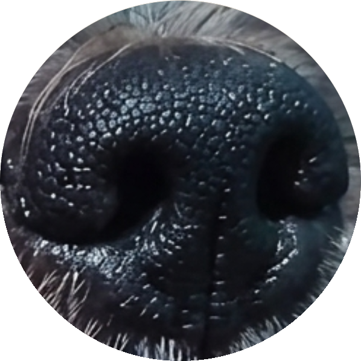
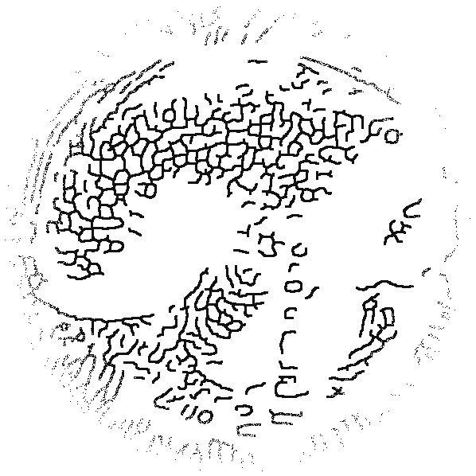
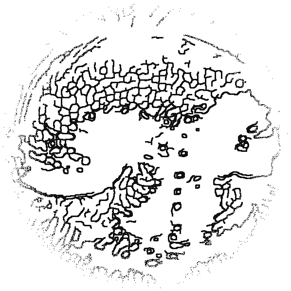
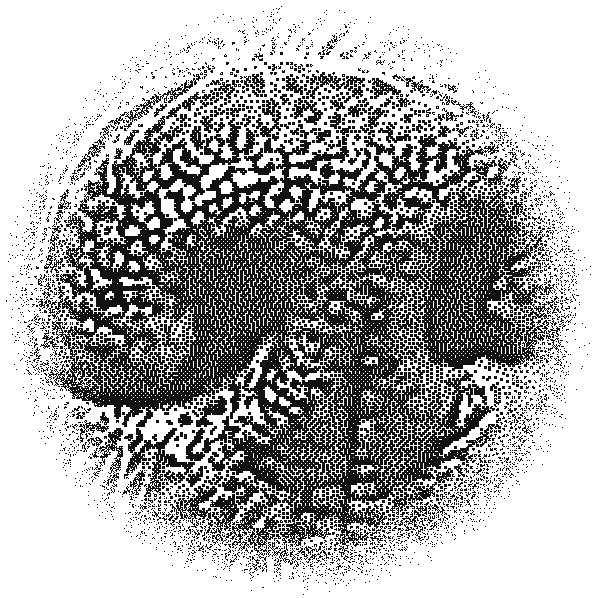

<p align="center">
  
</p>

<h1 align="center">NosePrint 🐾</h1>

<p align="center">
  Turn a photo of your dog's nose into tattoo-ready line art.<br>
  Web, Android and iOS from one Expo codebase. No accounts, no ads, no servers.
</p>

<p align="center">
  <a href="https://charlespura.github.io/NosePrint/"><b>Try it in your browser</b></a> ·
  <a href="https://github.com/charlespura/NosePrint/releases/latest">Download Android APK</a> ·
  <a href="https://charlespura.github.io/NosePrint/privacy.html">Privacy Policy</a>
</p>

<p align="center">
  
  
  
  
</p>

## Features

- **5 styles:** Sketch, Fineline, Stencil, Dotwork, Bold, plus presets
- **Editing:** eraser, undo/redo, ink colours, contrast, detail and line-thickness controls
- **Frames and text:** circle, heart or paw frame; add a name or date in 3 fonts
- **Real-size preview:** see how big the tattoo will be on skin
- **Export:** high-resolution PNG and vector SVG (for tattoo artists and stencil printers), or share straight to WhatsApp, Messenger, email and more
- **My Designs:** a gallery of saved designs, stored on the device
- **Private by design:** every image is processed on the device and never uploaded
- Light and dark mode

## Quick start

Requires Node.js 18+ (tested on 24).

```bash
npm install
npx expo start      # press w for web, or scan the QR code with Expo Go
```

## Scripts

| Command | What it does |
| --- | --- |
| `npm start` | Start the Expo dev server |
| `npm test` | Jest unit tests for the image pipeline |
| `npm run typecheck` | TypeScript strict check |
| `npm run lint` | ESLint (`expo lint`) |
| `npx expo-doctor` | Check dependencies and config |
| `npm run build:web` | Static web build in `dist/` |
| `npm run deploy` | Build and publish the web app to GitHub Pages |
| `npm run update:android` | Ship an over-the-air update to the `preview` channel |

Run `npm test`, `npm run typecheck` and `npm run lint` before committing.

## Building for the stores (EAS)

Build profiles are already set up in [`eas.json`](eas.json): `development`, `preview` (installable APK) and `production` (store builds with auto-incrementing version numbers).

```bash
npx eas-cli@latest login                                   # free Expo account
npx eas-cli@latest build -p android --profile preview      # APK for testing
npx eas-cli@latest build -p all --profile production       # Play Store AAB + App Store IPA
npx eas-cli@latest submit -p all                           # upload to the stores
```

- iOS builds need an Apple Developer account. EAS manages the signing credentials, so never commit keystores or `.p8` keys.
- Bundle ID / package name: `com.noseprint.app` (in [`app.json`](app.json)).
- Privacy policy URL for the store listings: https://charlespura.github.io/NosePrint/privacy.html
- Over-the-air updates use EAS Update with a fingerprint runtime version, so JavaScript-only changes can ship without a new store build.

## Web

The web app is hosted on GitHub Pages under `/NosePrint` (`experiments.baseUrl` in `app.json`). `npm run deploy` exports it, adds `404.html` and `.nojekyll`, and pushes `dist/` to the `gh-pages` branch.

- **Skia on web:** `public/canvaskit.wasm` is copied into the build. After upgrading Skia, run `npx setup-skia-web public` again.
- **Landing page:** on web, `/` shows a landing page ([`app/index.web.tsx`](app/index.web.tsx)) with a before/after slider and a narrated step-by-step demo. The app itself is at `/start`; phones open the app directly.
  - The demo images in `public/demo/` were rendered by the real pipeline.
  - The narration script and recording tips are in [docs/demo-narration.md](docs/demo-narration.md).
  - To freeze a demo frame for screenshots, open `/?demo=<0-4>&t=<ms>`.
- **APK download button:** the web Home screen shows "Download Android app (APK)". By default it links to the latest GitHub Release asset named `noseprint.apk`. To change the link, set `EXPO_PUBLIC_APK_URL` in `.env` before exporting.

## How it works

The pipeline in [`src/processing/`](src/processing) is pure TypeScript and covered by unit tests:

```
grayscale → histogram equalization (Contrast) → Gaussian blur (Smoothness)
→ mean adaptive threshold (Detail) → opening + speck removal + closing
→ Zhang–Suen thinning → dilate (Line thickness) → circle mask
```

The preview renders at 512 px, 150 ms after the last change. Export runs the pipeline again at full crop resolution (up to 2048 px).

## Project layout

```
app/                 Expo Router screens (index, start, crop, editor, export, designs, about)
src/processing/      pure-TS image pipeline + Jest tests
src/skia/            Skia decode/encode (lazy-loaded; CanvasKit on web)
src/components/      UI building blocks
src/screens/         shared screen content (Home)
src/landing/         web landing page demo player
src/storage/         gallery save, share, My Designs (files on native, IndexedDB on web)
src/state/           in-memory hand-off between screens
src/theme/           colours, light/dark mode
scripts/             icon generator, web post-export step
public/              static web files (canvaskit.wasm, demo assets, privacy policy)
marketing/           promo video
```

To redraw the app icon, Android adaptive icons, splash screen and favicon, run `node scripts/make-icons.js`.

## Roadmap

- Move heavy processing off the main thread (Web Worker / background thread). Full-resolution export can pause briefly on older phones.

## Privacy

NosePrint collects no personal data. Photos and designs stay on your device. See the full [privacy policy](https://charlespura.github.io/NosePrint/privacy.html).

## License

See [LICENSE](LICENSE).
